# Visual reference

Examples of every supported geometry, material and texture. Each entry links to
the complete scene that produced it; snippets show the relevant scene syntax.
Geometry examples use the same blue Phong material unless otherwise noted.
Material examples use the same sphere and lighting where practical.

Jump to [geometry](#geometry), [materials](#materials) or [textures](#textures).
Images use **640 x 400 pixels and 256 fixed samples per pixel**, without
denoising. From the repository root, render one or regenerate all images:

```powershell
.\build\bin\hiprt_demo.exe --scene .\scenes\reference\geometry-sphere.hipscene -o .\docs\images\reference\geometry-sphere.png --width 640 --height 400 --sampling fixed --samples 256

Get-ChildItem .\scenes\reference\*.hipscene | ForEach-Object {
    .\build\bin\hiprt_demo.exe --scene $_.FullName -o (Join-Path .\docs\images\reference ($_.BaseName + '.png')) --width 640 --height 400 --sampling fixed --samples 256
    if ($LASTEXITCODE -ne 0) { throw "Rendering failed: $($_.Name)" }
}
```

The text example uses `C:\Windows\Fonts\arial.ttf`, as do the existing text
demos. On other systems, edit the scene to use a locally licensed TrueType or
OpenType font. The mesh example uses the included original pyramid PLY.
Re-rendered images can vary slightly with GPU and compiler.

## Geometry

Object snippets refer to a previously defined named material. The six quadratic
shapes use the shared analytic GPU Quadric; the four height-limited shapes are
closed and aligned with Y. See [Quadrics](../README.md#quadrics) for dimensions
and conventions.

### Sphere

An analytic sphere, specified by its center and radius.

```text
sphere { center [0, 1, 0] radius 1 material demo }
```

[Scene](../scenes/reference/geometry-sphere.hipscene)

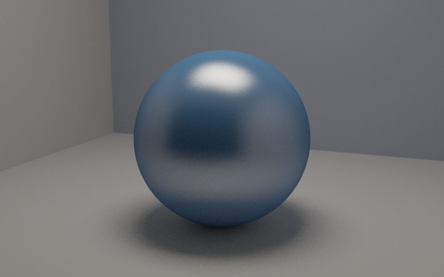

### Ellipsoid

An analytic ellipsoid with separate X, Y and Z semiaxes.

```text
ellipsoid { center [0, 1.15, 0] radii [0.8, 1.15, 0.6] material demo }
```

[Scene](../scenes/reference/geometry-ellipsoid.hipscene)

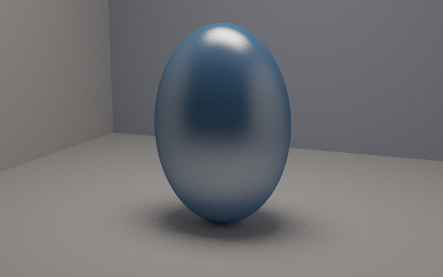

### Cylinder

A closed cylinder with flat end caps.

```text
cylinder { center [0, 1, 0] radius 0.8 height 2 material demo }
```

[Scene](../scenes/reference/geometry-cylinder.hipscene)

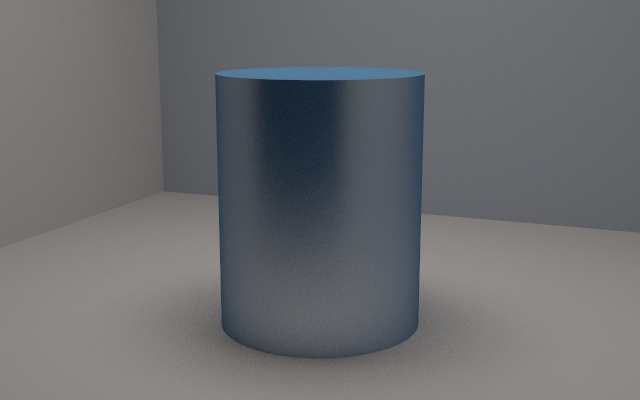

### Cone

A closed cone with its base below and apex above.

```text
cone { center [0, 1, 0] radius 1 height 2 material demo }
```

[Scene](../scenes/reference/geometry-cone.hipscene)

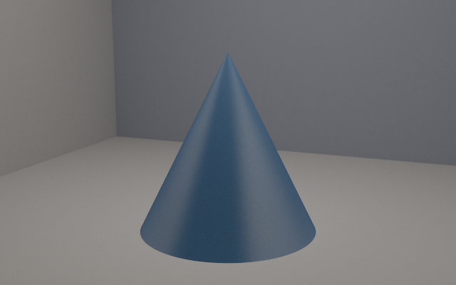

### Paraboloid

A paraboloid with its vertex below and a flat cap above.

```text
paraboloid { center [0, 1, 0] radius 1 height 2 material demo }
```

[Scene](../scenes/reference/geometry-paraboloid.hipscene)

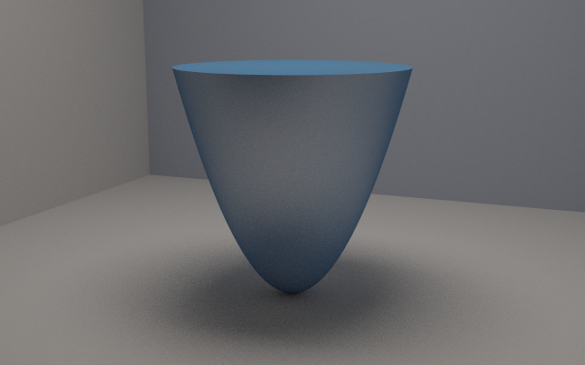

### Hyperboloid

A capped one-sheet hyperboloid. `radius` is its waist radius and `axial_radius`
controls its flare.

```text
hyperboloid { center [0, 1, 0] radius 0.6 axial_radius 1 height 2 material demo }
```

[Scene](../scenes/reference/geometry-hyperboloid.hipscene)

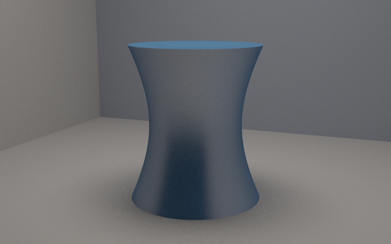

### Torus

An analytic ring. `tilt_x` rotates it in degrees; `minor_radius` must be less
than `major_radius`.

```text
torus { center [0, 1.2, 0] major_radius 0.85 minor_radius 0.3 tilt_x 70 material demo }
```

[Scene](../scenes/reference/geometry-torus.hipscene)

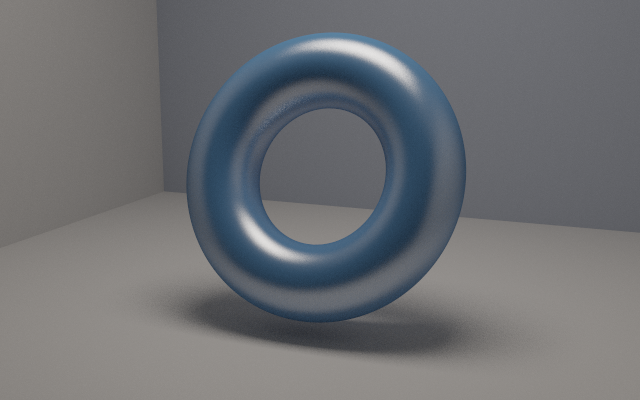

### Rectangle

A planar rectangle in XZ, facing downward. Here it is emissive so its lower
face and illumination are visible.

```text
material lamp = emissive [12, 11, 10]
rectangle { center [0, 2.5, 0] width 2.4 depth 1.5 material lamp }
```

[Scene](../scenes/reference/geometry-rectangle.hipscene)

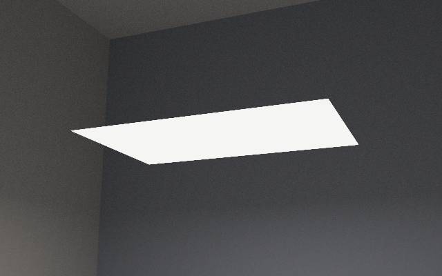

### PLY triangle mesh

An imported, already triangulated PLY mesh. `fit` uniformly scales it and
`position` places its bottom. The path is relative to the scene.

```text
mesh { file "pyramid.ply" up y fit [2, 2, 2] position [0, 0.02, 0] material demo }
```

[Scene](../scenes/reference/geometry-mesh.hipscene) ·
[PLY](../scenes/reference/pyramid.ply)

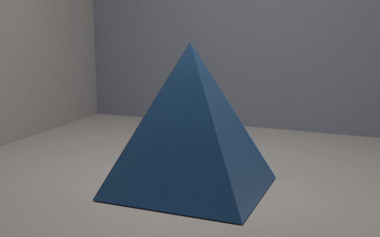

### Procedural cat

The built-in low-poly cat has a fixed position and material; it is not a mesh
block.

```text
cat
```

[Scene](../scenes/reference/geometry-cat.hipscene)

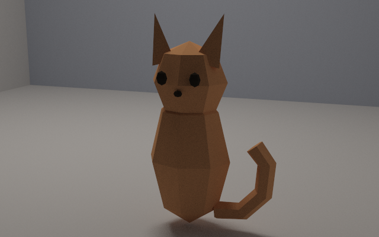

### Procedural crystal

The built-in faceted crystal has a fixed position and material.

```text
crystal
```

[Scene](../scenes/reference/geometry-crystal.hipscene)

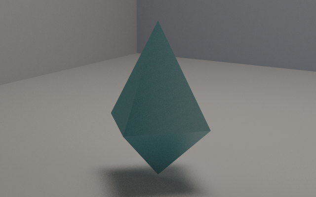

### Extruded text

FreeType outlines are extruded analytically, retaining curved outlines and
counters without triangulation. This example requires Windows Arial.

```text
text { font "C:\\Windows\\Fonts\\arial.ttf" value "HIP" size 1.5 depth 0.4 position [-1.4, 0.05, 0] material demo }
```

[Scene](../scenes/reference/geometry-text.hipscene)

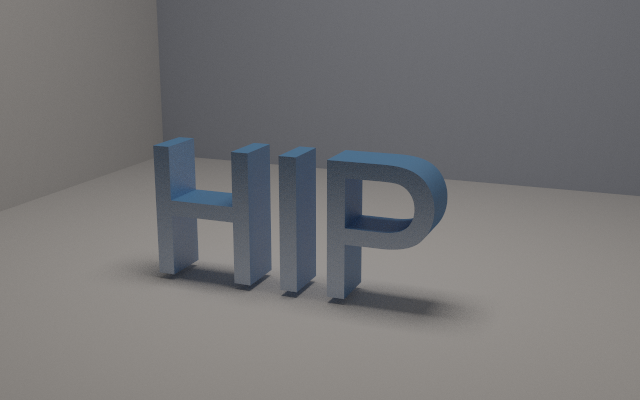

### CSG union

A Boolean union combines both closed operands; operations can be nested.
See [CSG](../README.md#csg-union-intersection-and-difference) for supported
operands and numerical details.

```text
csg { material demo union {
    sphere { center [-0.5, 1, 0] radius 1 }
    sphere { center [0.5, 1, 0] radius 1 }
} }
```

[Scene](../scenes/reference/csg-union.hipscene)

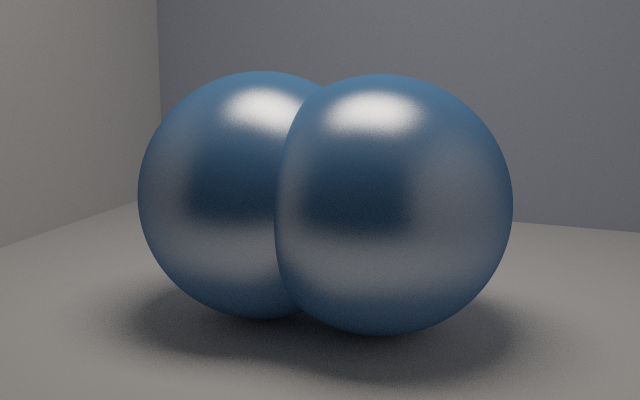

### CSG intersection

An intersection retains only the volume shared by both operands.

```text
csg { material demo intersection {
    sphere { center [-0.45, 1, 0] radius 1 }
    sphere { center [0.45, 1, 0] radius 1 }
} }
```

[Scene](../scenes/reference/csg-intersection.hipscene)

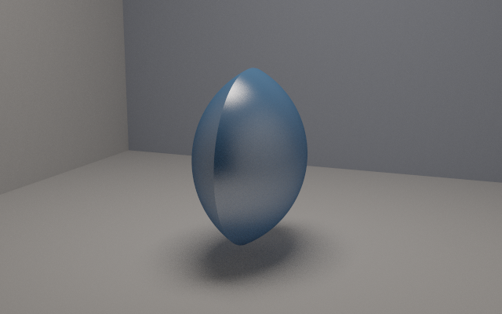

### CSG difference

A difference removes the second operand from the first; the object material
also covers the cut surface.

```text
csg { material demo difference {
    cylinder { center [0, 1, 0] radius 1 height 2 }
    sphere { center [0.25, 1.4, 0.8] radius 0.75 }
} }
```

[Scene](../scenes/reference/csg-difference.hipscene)

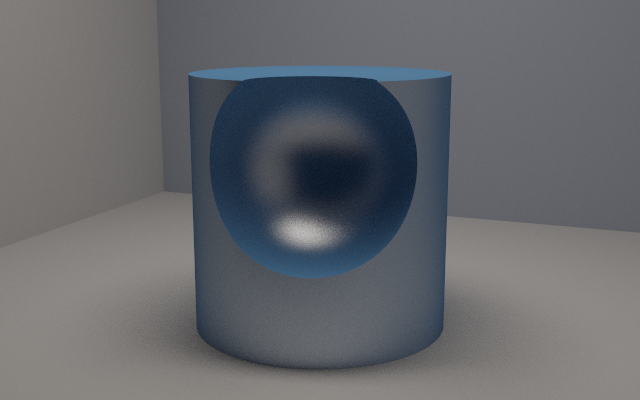

## Materials

Material definitions precede objects; each object refers to a material by name.

### Diffuse

Matte Lambertian reflection without a glossy highlight.

```text
material demo = diffuse [0.15, 0.42, 0.85]
```

[Scene](../scenes/reference/material-diffuse.hipscene)

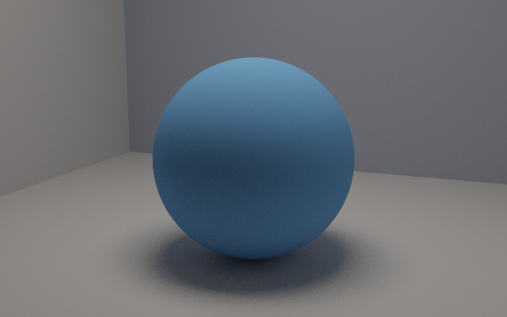

### Phong

Diffuse reflection plus a glossy specular lobe.

```text
material demo = phong [0.15, 0.42, 0.85]
```

[Scene](../scenes/reference/material-phong.hipscene)


### Metal

Colored metallic reflection; roughness 0 is mirror-like and larger values
blur reflections.

```text
material demo = metal [0.92, 0.62, 0.25] roughness 0.12
```

[Scene](../scenes/reference/material-metal.hipscene)

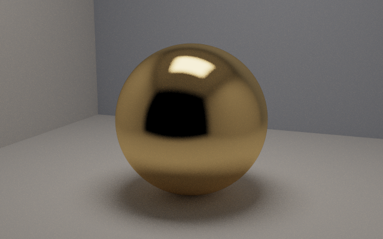

### Glass

Transparent dielectric with reflection and refraction; the tile floor makes
distortion visible.

```text
material demo = glass [0.96, 0.99, 1]
```

[Scene](../scenes/reference/material-glass.hipscene)

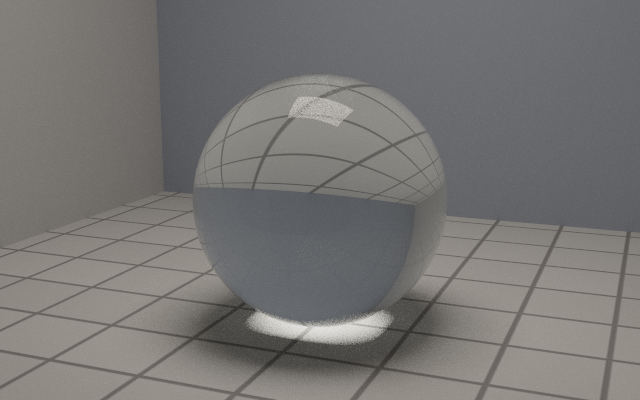

### Emissive

Emits one-sided radiance rather than reflecting light. This torus is also
sampled for direct illumination.

```text
material demo = emissive [8, 3, 1]
```

[Scene](../scenes/reference/material-emissive.hipscene)

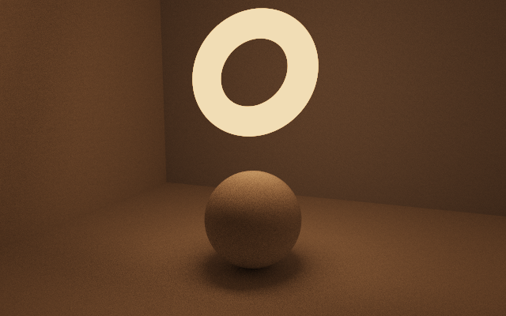

## Textures

These procedural presets are room-surface textures, not general texture maps
on objects. Constant color is available on every room surface; the other
presets are restricted to the indicated surfaces.

### Constant color

A constant RGB room surface.

```text
back color [0.2, 0.45, 0.8]
```

[Scene](../scenes/reference/texture-color.hipscene)


### Tiles

Procedural floor tiles with grout and a bevel shading-normal effect. Available
on the floor.

```text
floor tiles_detail
```

[Scene](../scenes/reference/texture-tiles.hipscene)

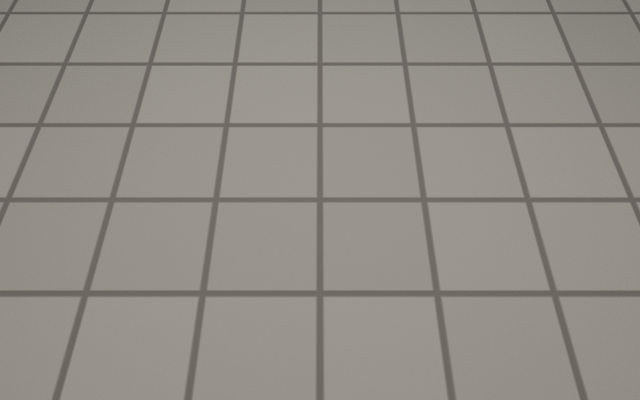

### Wood

Procedural wood grain, available on the back wall or ceiling.

```text
back wood_detail
```

[Scene](../scenes/reference/texture-wood.hipscene)

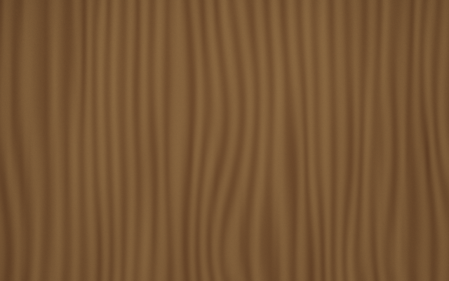

### Marble

Procedural marble with dark veins, available on the back wall.

```text
back marble_detail
```

[Scene](../scenes/reference/texture-marble.hipscene)

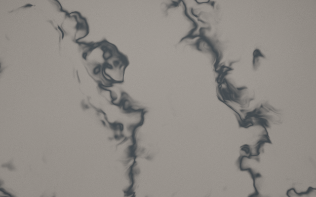

### Mandelbrot

A procedural Mandelbrot fractal, available on the left wall.

```text
left mandelbrot_detail
```

[Scene](../scenes/reference/texture-mandelbrot.hipscene)

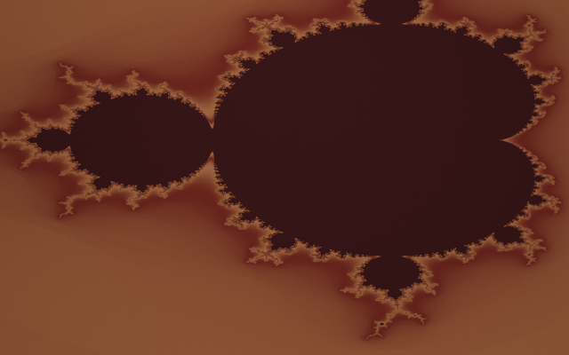

### Julia

A procedural Julia fractal, available on the right wall.

```text
right julia_detail
```

[Scene](../scenes/reference/texture-julia.hipscene)

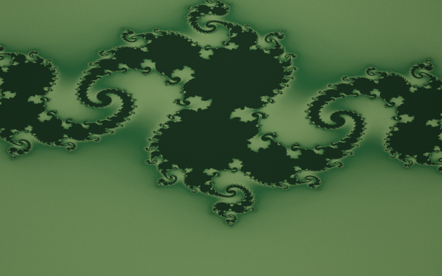
